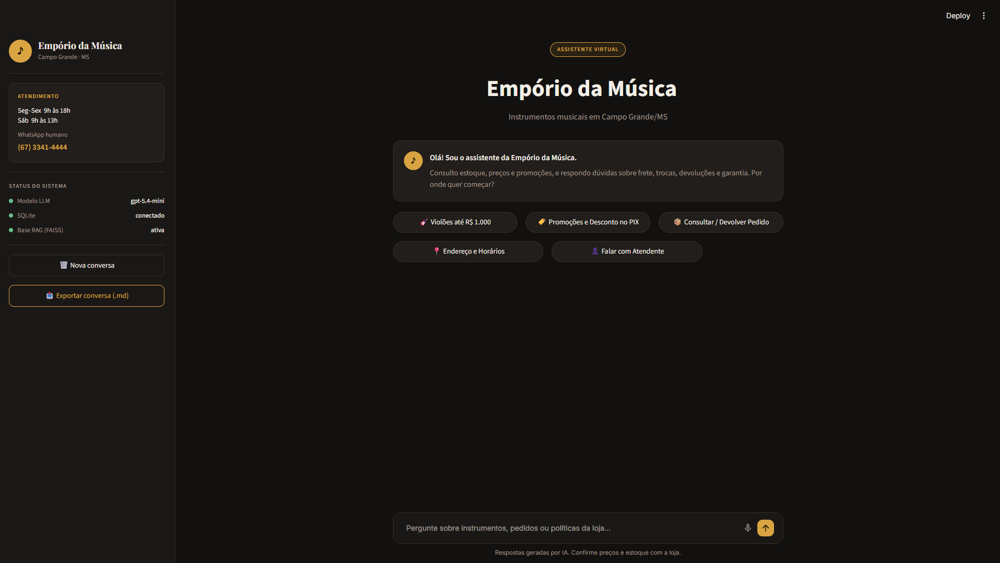
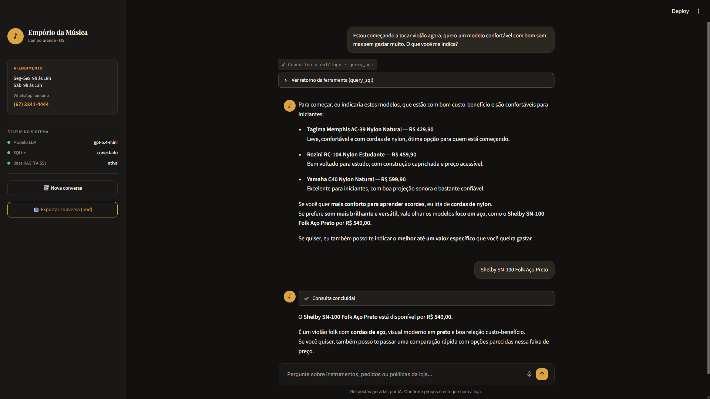
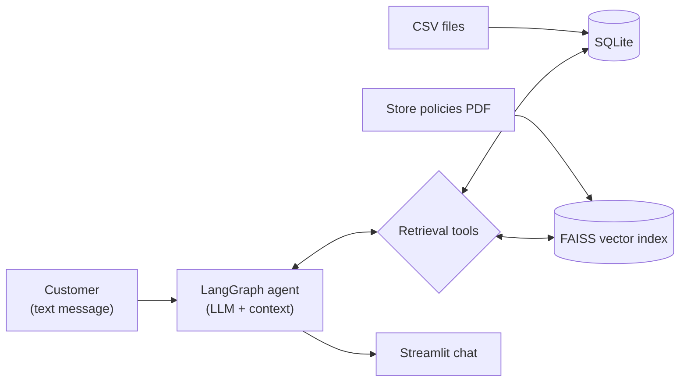

# Empório da Música — AI Customer Service Assistant

[-green.svg)](README.pt-br.md)

A full-stack conversational assistant for a fictional music store in Campo Grande, Brazil. It answers customer questions about products, prices, stock, promotions, orders, and store policies.

The application combines **Text-to-SQL** for structured store data and **RAG** for policy documents. **LangGraph** orchestrates the agent workflow, and **Streamlit** provides the chat interface.

## Application Preview

| Main interface (Figma Design) | Example conversation (Catalog Query) |
|---|---|
|  |  |

## Example Interactions

> 📸 **Full Test Transcripts & Screenshots:**  
> For complete step-by-step logs, SQL queries, policy retrieval results, and interface screenshots, see [**`examples/example_conversations.md`**](examples/example_conversations.md).

### 1. Product and Availability Query

- **Customer:** "Estou começando a tocar violão agora, quero um modelo confortável com bom som mas sem gastar muito. O que você me indica?"
- **Assistant:** Recommends accessible nylon-string options for beginner comfort (Tagima Memphis AC-39 at R$ 429.90, Rozini RC-104 at R$ 459.90, Yamaha C40 at R$ 599.90) and suggests a steel-string alternative (Shelby SN-100 Folk at R$ 549.00) for players seeking a brighter acoustic sound.
- **Customer:** "Shelby SN-100 Folk Aço Preto"
- **Assistant:** Confirms availability and price (R$ 549.00) directly from the SQLite catalog view (`vw_catalogo_produtos`).

### 2. Order Status Query (Hybrid with Store Policies)

- **Customer:** "Olá! Sou o Lucas Mendes da Silva, fiz o pedido #4. Qual foi o produto que comprei, qual o status da entrega e se tiver defeito ou me arrepender, quais são as regras de devolução e garantia?"
- **Assistant:**
  - *Data retrieved via SQL:* Order #4 (Giannini GF-3D Dreadnought Sunburst, R$ 799.90, status `delivered`).
  - *Policies retrieved via RAG:* 7-day online purchase withdrawal right with free return shipping, 30-day store defect exchange, and 1-year manufacturer warranty.

### 3. Store Policy and Active Promotion Question

- **Customer:** "O violão Taylor 110e Dreadnought está em promoção? Quanto fica no PIX?"
- **Assistant:** Confirms the active 8% promotional discount (R$ 5,999.00 -> R$ 5,519.08) and explains that the 5% Pix discount does not stack with active promotions, applying the most favorable discount.

## Architecture

CSV data is cleaned and loaded into SQLite. The store policy PDF is indexed in FAISS. A LangGraph agent chooses the appropriate retrieval tool and returns the response through Streamlit.



## Key Features

- **Product catalog:** prices, specifications, promotions, and availability.
- **Order tracking:** order details and status.
- **Store policies:** answers about shipping, returns, warranties, and procedures.
- **Hybrid retrieval:** SQL for structured data and vector search for policy documents.
- **Custom chat UI:** Streamlit interface with tool inspection, conversation export to Markdown, and optional voice input.

## Technology and Design Decisions

| Area | Technology | Purpose |
|---|---|---|
| Agent orchestration | LangGraph | Manages the agent–tool workflow and limits tool iterations |
| LLM | `gpt-5.4-mini` | Interprets requests, generates SQL, and selects retrieval tools |
| Structured retrieval | SQLite + SQL views | Supports precise product, inventory, promotion, and order queries |
| Semantic retrieval | FAISS + `text-embedding-3-small` | Retrieves relevant passages from store policies |
| PDF processing | pypdf | Extracts policy text before chunking and indexing |
| Interface | Streamlit | Provides the customer-facing chat |

### Exploratory Analysis and Data Preparation

Before implementing the retrieval workflow, I explored the six CSV tables and the store policy document in `notebooks/analise_exploratoria.ipynb`. This helped identify table relationships, relevant fields, data inconsistencies, and business rules that needed to be reflected in the application.

Based on that analysis, the CSV files are cleaned and loaded into SQLite during initialization instead of being passed directly to the LLM or manipulated through generated Python/Pandas code at runtime.

The preparation includes:
- Trimming unnecessary whitespace and normalizing selected values.
- Setting the stock of discontinued products to zero, preventing them from appearing available even when the source CSV contains a positive quantity.
- Extracting selected JSON product attributes into relational fields to make them easier to query.

SQLite and the SQL views provide a structured and repeatable retrieval layer. The views `vw_catalogo_produtos` and `vw_pedidos_detalhados` consolidate catalog and order information and apply business rules, including the 5% Pix discount not combining with active promotions. This reduces the amount of joining and business-rule calculation the LLM must perform at query time, helping avoid inconsistent SQL and incorrect answers.

The `query_sql` tool includes basic checks intended to restrict execution to read-only queries. These checks are an application-level safeguard, not a complete database security boundary.

### Hybrid Retrieval: Text-to-SQL and RAG

The two data sources require different retrieval strategies:

- **Text-to-SQL:** used for precise questions about products, prices, promotions, inventory, and orders. The agent generates SQL against the prepared SQLite schema and views.
- **RAG:** used for information in `politicas_loja.pdf`. The PDF text is split into 1,000-character chunks with 200-character overlap, embedded using `text-embedding-3-small`, and stored in a local FAISS index. The retriever returns the five most relevant chunks.

The agent can call both tools in one interaction when a question requires structured data and policy information.

### LLM Choice

The `gpt-5.4-mini` model was selected to balance reasoning capability, response latency, and operational cost. Text-to-SQL is the most demanding part of this application because it requires interpreting relational schemas, joins, filters, and business rules before generating a valid query. A larger model could increase cost without proportional benefits for the overall workflow, while a smaller model may struggle with more complex SQL generation.

The model choice does not mean every component requires a large LLM. Embedding generation and vector retrieval are separate tasks, and smaller local models can be sufficient for many RAG use cases, such as embedding documents or producing straightforward answers grounded in retrieved passages.

### Agent Workflow, Prompt Strategy, and Conversation Context

LangGraph coordinates an agent node and a tool node. The agent decides whether to answer directly or call `query_sql` and/or `search_store_policies`. It can use tool results in another agent turn before producing the final answer. A configurable tool-iteration limit routes execution to a finalization step.

Prompt instructions define how the agent should use the available sources and tools, keep answers concise and customer-oriented, suggest alternatives for unavailable products, and handle out-of-scope or prompt-injection requests. They also guide the agent to base factual answers on retrieved information instead of filling gaps with assumptions. These instructions improve consistency but are not a substitute for application-level security.

Conversation context is maintained in Streamlit's `st.session_state` for the active session. Persistent history and mandatory login were not included because the challenge focuses on an informational customer-service assistant, not authenticated transactions or ticket management. Session-scoped context supports follow-up questions without adding sign-in friction for store visitors. Customers can export the conversation as Markdown from the sidebar.

## Project Structure

```text
desafio-ai-engineer-artefact/
├── .streamlit/   # Streamlit theme configuration
├── agent/        # Chatbot initialization, LangGraph workflow, LLMs, and tools
├── data/         # Six CSV files and store policy PDF
├── db/           # CSV cleaning, SQLite setup, and SQL views
├── examples/     # Documented conversation scenarios and screenshots
│   └── images/   # Real UI application captures
├── notebooks/    # Exploratory analysis of tables and business rules
├── prompts/      # System prompt and customer-service rules
├── rag/          # PDF processing and FAISS index
├── ui/           # Modular Streamlit interface
├── app.py        # Application entry point
└── requirements.txt
```

## Installation and Execution

### Requirements

- Python 3.11+
- OpenAI API key for the default LLM and embeddings (also used by the optional voice-input feature)

### 1. Clone the repository

```bash
git clone https://github.com/cesaryuri/desafio-ai-engineer-artefact.git
cd desafio-ai-engineer-artefact
```

### 2. Create and activate a virtual environment

**Windows (PowerShell)**
```powershell
python -m venv .venv
.\.venv\Scripts\Activate.ps1
```

**Linux / macOS**
```bash
python3 -m venv .venv
source .venv/bin/activate
```

### 3. Install dependencies

```bash
pip install -r requirements.txt
```

### 4. Configure environment variables

Create a `.env` file in the project root directory and add your API credentials.

Example `.env` configuration:

```env
# Database (leave empty to automatically use the local SQLite generated at db/emporio_musica.db)
DATABASE_URL=""

# LLM Provider and Model
LLM_PROVIDER="openai"
LLM_MODEL="gpt-5.4-mini"

# RAG Vector Store Embeddings (FAISS)
EMBEDDING_PROVIDER="openai"
EMBEDDING_MODEL="text-embedding-3-small"

# Speech-to-Text Model (Voice Input)
OPENAI_STT_MODEL="gpt-4o-mini-transcribe"

# API Key
OPENAI_API_KEY="your-openai-api-key"

# Maximum agent tool iterations per turn
MAX_AGENT_STEPS="10"
```

> **Security Note:** Do not commit `.env` or expose API keys. The `.env` file is already included in `.gitignore`.

### 5. Run the application

```bash
streamlit run app.py
```

On the first run, the application cleans and imports the six CSV files into SQLite, creates the SQL views, and indexes `politicas_loja.pdf` in the local FAISS store.

## Limitations and Future Improvements

**Current limitations**
- SQLite and the FAISS index are local to the application.
- Conversation context is maintained only during the active Streamlit session; it is not persisted across sessions.
- **Context cross-contamination in long dialogues:** In extended multi-turn sessions (e.g. querying a customer order and later requesting general store support contacts), the LLM can occasionally pull customer-specific details (such as the customer phone or email from previous tool calls) instead of official store contacts. When asked to clarify, the agent correctly queries `search_store_policies` and self-corrects with official store contacts.
- SQL validation is basic and is not production-grade database security.
- The current workflow uses a single configured LLM rather than selecting models by task.

**Possible improvements**
- **Deterministic store-support tool and PII scrubbing:** Add a dedicated, deterministic `get_store_info` tool for official store channels instead of relying on semantic RAG retrieval, combined with PII masking in SQL outputs (e.g. `lu***@jmail.com`) to prevent customer data from leaking into institutional responses.
- **Task-specific model evaluation:** compare models with different capability, cost, and latency profiles. A stronger model could handle complex Text-to-SQL generation, while smaller local models (such as Llama or Gemma variants) and local embedding models could be evaluated for policy retrieval and simpler language tasks. A lightweight model could also be tested for synthesizing final answers after tool execution. Any model selection strategy should be validated against answer quality, latency, and cost before adoption.
- **Quality evaluation:** build a test set covering SQL correctness, retrieval relevance, factual consistency, and answer usefulness. Frameworks such as DeepEval could support automated evaluation, complemented by review from people familiar with the store's products and policies.
- **Production readiness:** add authenticated customer sessions, server-side order authorization, persistent conversation history, and human-agent handoff with an automatic conversation summary.
- **Improved product discovery:** combine SQL filters with semantic search over product descriptions.

## AI-Assisted Development

I used Claude and Antigravity with Gemini as development-support tools for exploration, implementation assistance, and code review.

The Streamlit interface was developed based on a Figma prototype, which helped guide the visual layout and user experience. AI-generated suggestions were reviewed and adapted to the project's requirements, including improvements to chatbot initialization, customer-facing stock responses, and interface styling. The final implementation and technical decisions were evaluated against the challenge requirements.
