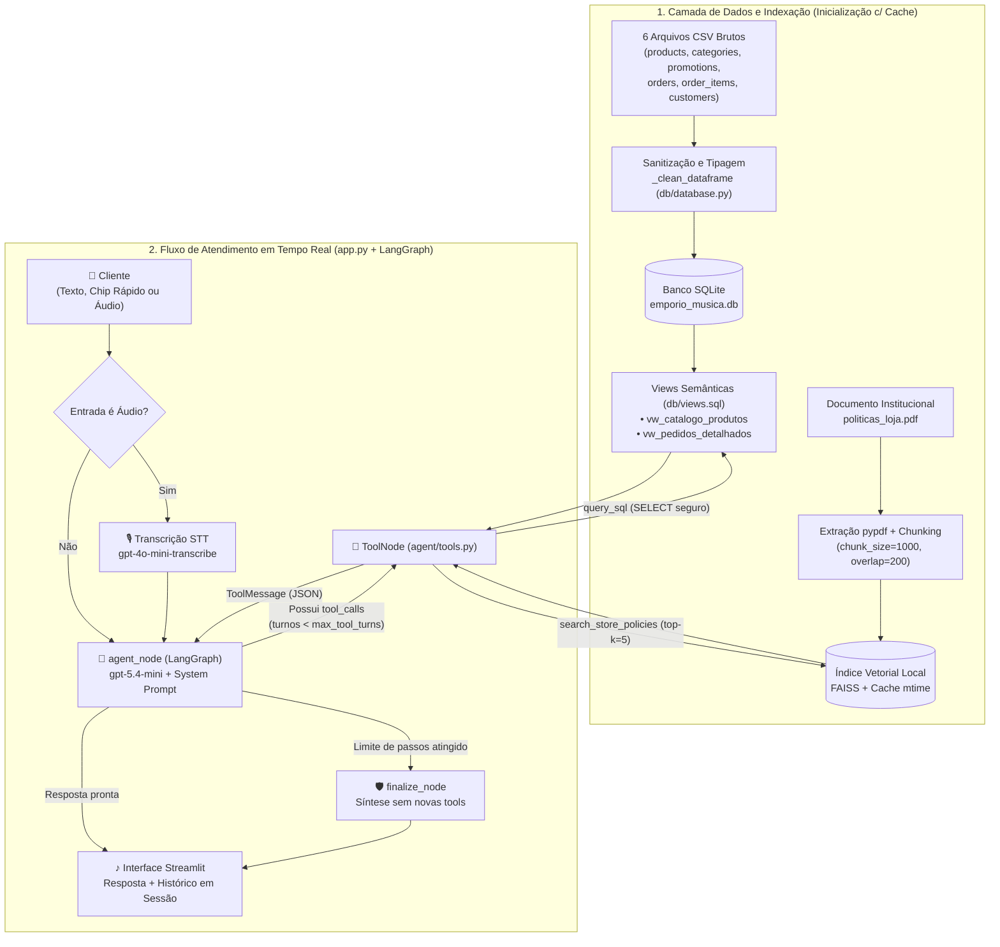

# 🎸 Empório da Música — Assistente Virtual Inteligente

Assistente virtual conversacional Full-Stack desenvolvido para a **Empório da Música** (Campo Grande/MS). O projeto adota uma **arquitetura híbrida de recuperação de dados** — unindo consultas relacionais em tempo real (**Text-to-SQL em SQLite com Views Semânticas**) e busca semântica em documentos (**RAG Vetorial com FAISS**) — orquestrada por um grafo de agentes em **LangGraph**, com interface customizada a partir de protótipo no **Figma** e suporte a **entrada por voz (Speech-to-Text)**.

> 📄 **Exemplos de Conversas:** Veja os 5 cenários reais documentados em [`examples/exemplos_conversas.md`](examples/exemplos_conversas.md).

---

## 📸 Demonstração Visual e Funcionalidades

> *(Espaço reservado para as capturas de tela da aplicação em funcionamento)*

| Tela Inicial (Design Figma) | Consulta Híbrida e Inspeção de Tools |
| :---: | :---: |
|  |  |
| *Hero institucional, status do sistema em tempo real e atalhos rápidos* | *Transparência nas chamadas `query_sql` e `search_store_policies`* |

| Entrada por Voz (Speech-to-Text) | Transbordo Humano e Exportação `.md` |
| :---: | :---: |
|  |  |
| *Gravação nativa no chat transcrita via `gpt-4o-mini-transcribe`* | *Exportação do histórico completo em Markdown pela sidebar* |

### Diferenciais Implementados Além do Escopo Básico
- 🎙️ **Atendimento por Voz (STT)**: O cliente pode falar diretamente pelo microfone na barra de chat; o áudio é transcrito em português (`gpt-4o-mini-transcribe`) e processado pelo mesmo grafo de agentes.
- 🎨 **UI Autoral Fiel ao Figma**: Interface escura modularizada seguindo responsabilidade única (`ui/sidebar.py`, `ui/welcome.py`, `ui/chat.py`, `ui/styles.py`), com indicadores de conexão do banco/RAG, chips de ação rápida e visualização expansível do JSON retornado por cada ferramenta.
- 📥 **Exportação de Conversa (`.md`)**: Botão nativo na barra lateral para baixar o histórico completo do atendimento em Markdown.
- 🧹 **Pipeline de Sanitização CSV → SQLite + Views**: Os arquivos CSV brutos não são lidos diretamente pelo LLM; passam por limpeza, tipagem e consolidação em *Views* SQL antes de qualquer consulta.

---

## 1. Arquitetura da Solução

O diagrama abaixo representa de forma fiel os dois estágios reais do código: **(1) Ingestão, Sanitização e Indexação** (`db/` e `rag/`) e **(2) Orquestração do Agente no LangGraph** (`agent/` e `app.py`):



### Estrutura de Pastas

```text
desafio-ai-engineer-artefact/
├── .streamlit/
│   └── config.toml                # Tema escuro nativo alinhado à paleta do Figma
├── agent/
│   ├── chatbot.py                 # Inicialização unificada do assistente (SQLite, RAG, Prompt e Grafo)
│   ├── graph.py                   # Grafo LangGraph (agent_node, ToolNode, finalize_node, should_continue)
│   ├── llm.py                     # Instanciação multi-provider de LLMs, Embeddings e transcrição de áudio
│   └── tools.py                   # Ferramentas query_sql (c/ trava read-only) e search_store_policies
├── data/                          # Base bruta fornecida (6 CSVs + politicas_loja.pdf)
├── db/
│   ├── database.py                # Pipeline CSV -> sanitização Pandas -> SQLite + execução de views.sql
│   └── views.sql                  # Views vw_catalogo_produtos e vw_pedidos_detalhados
├── docs/images/                   # Capturas de tela da interface e fluxos de conversa
├── examples/
│   └── exemplos_conversas.md      # 5 cenários reais de conversação documentados
├── notebooks/
│   └── analise_exploratoria.ipynb # EDA prévia das tabelas, cruzamentos e regras de negócio
├── prompts/
│   ├── prompt_rules.py            # Postura comercial, regras de negócio e _CHAIN_OF_THOUGHT
│   └── system_prompt.py           # Montagem do prompt operacional com injeção do schema SQL
├── rag/
│   ├── pdf_processor.py           # Leitura do PDF e divisão em chunks semânticos
│   └── vectorstore.py             # Criação/carregamento do índice FAISS com validação de timestamp
├── ui/
│   ├── chat.py                    # Histórico, captura texto/áudio e streaming das tools
│   ├── sidebar.py                 # Barra lateral, status do sistema e exportação .md
│   ├── styles.py                  # Folha de estilos CSS fiel ao protótipo do Figma
│   └── welcome.py                 # Estado inicial (Hero, card de boas-vindas e atalhos rápidos)
├── app.py                         # Ponto de entrada Streamlit (orquestração de sessão, áudio e streaming)
└── requirements.txt               # Dependências do projeto
```

---

## 2. Instruções de Instalação e Execução

### Pré-requisitos
- **Python 3.11+**
- Chave de API da OpenAI (`OPENAI_API_KEY`) — ou de outro provedor configurado no `.env`.

### Passo a passo

1. **Clone o repositório e acesse o diretório:**
   ```bash
   git clone https://github.com/cesaryuri/desafio-ai-engineer-artefact.git
   cd desafio-ai-engineer-artefact
   ```

2. **Crie e ative um ambiente virtual:**
   ```bash
   # Windows (PowerShell)
   python -m venv .venv
   .\.venv\Scripts\Activate.ps1

   # Linux / macOS
   python3 -m venv .venv
   source .venv/bin/activate
   ```

3. **Instale as dependências:**
   ```bash
   pip install -r requirements.txt
   ```

4. **Configure o arquivo `.env`:**
   Copie o modelo `.env.example` para `.env` e insira sua chave da OpenAI:
   ```bash
   cp .env.example .env
   ```
   Variáveis principais do `.env`:
   ```env
   LLM_PROVIDER="openai"
   LLM_MODEL="gpt-5.4-mini"
   EMBEDDING_PROVIDER="openai"
   EMBEDDING_MODEL="text-embedding-3-small"
   OPENAI_API_KEY="sua-chave-openai-aqui"

   DATABASE_URL="sqlite:///db/emporio_musica.db"
   MAX_AGENT_STEPS="10"
   ```

5. **Inicie a aplicação:**
   ```bash
   streamlit run app.py
   ```
   > Na primeira execução, o sistema sanitiza automaticamente os 6 CSVs, constrói o banco `db/emporio_musica.db` com as views analíticas e indexa o `politicas_loja.pdf` na pasta `faiss_index_local/`.

---

## 3. Justificativa das Decisões Técnicas

### 3.1. Por que migrar os CSVs para SQLite + Views em vez de consultar CSV direto?
Uma abordagem comum em protótipos rápidos é carregar os CSVs diretamente em DataFrames Pandas a cada pergunta (usando agentes de código Python) ou injetar linhas de CSV no prompt. Descartei essa abordagem por três motivos práticos identificados na análise exploratória (`notebooks/analise_exploratoria.ipynb`):
1. **Sanitização e Tratamento de Anomalias (`db/database.py`)**: Na função [`_clean_dataframe`](db/database.py), antes de persistir no SQLite, os dados passam por três tratamentos descobertos na EDA:
   - Remoção de espaços residuais (`strip()`) em todas as colunas de texto;
   - **Correção de anomalia de estoque**: produtos com `status == "discontinued"` que constavam no CSV bruto com `stock_quantity > 0` têm o estoque forçado para `0`, evitando que o assistente ofereça como disponíveis itens fora de linha;
   - **Desempacotamento da coluna JSON `specs`**: extração dos atributos `strings` (nylon/aço), `electronics` e `color` para colunas relacionais diretas na tabela `products`, facilitando filtros SQL simples.
2. **Segurança e Determinismo**: Agentes que executam Python sobre DataFrames (`eval`/`exec`) abrem brechas de execução de código arbitrário e frequentemente erram cruzamentos entre múltiplas tabelas (`orders` ↔ `order_items` ↔ `customers` ↔ `products`). No SQLite, a tool `query_sql` aceita exclusivamente comandos `SELECT` (bloqueando `DROP`, `DELETE`, `UPDATE`, `INSERT`, `PRAGMA`, etc. via regex) e opera com integridade relacional.
3. **Encapsulamento da Regra de Negócio em Views (`db/views.sql`)**:
   - A tabela `promotions` possui promoções ativas (`is_active = 1`) e inativas (`is_active = 0`). Além disso, o PDF de políticas define que o **desconto de 5% no PIX não é cumulativo com promoções ativas**.
   - Se deixássemos o LLM montar o `JOIN` e calcular porcentagens a cada pergunta, haveria risco de alucinação aritmética ou aplicação de promoção expirada.
   - Com as views `vw_catalogo_produtos` e `vw_pedidos_detalhados` priorizadas nas regras de negócio do agente, o banco já entrega prontos o `final_price_brl`, o `pix_price_brl` (não cumulativo) e o `availability_status`, eliminando erros de cálculo aritmético pelo LLM.

### 3.2. Arquitetura Híbrida de Recuperação (Text-to-SQL + RAG Vetorial)
Os dados da Empório da Música possuem naturezas distintas e exigem mecanismos complementares:
- **Consultas Exatas, Filtros de Preço e Pedidos → `query_sql` (SQLite)**: Vetorizar catálogo de produtos ou pedidos para busca por similaridade (RAG puro) funciona mal para filtros numéricos (`preco <= 1000`), checagem de estoque exato (`stock_quantity > 0`) ou busca de pedido por ID/CPF. O SQL resolve essas perguntas com precisão de 100%.
- **Políticas Comerciais, Frete, Trocas e Garantia → `search_store_policies` (FAISS RAG)**: Já o conteúdo de `politicas_loja.pdf` é textual e semântico. Ele é dividido em blocos (`chunk_size=1000`, `chunk_overlap=200`) e indexado localmente no FAISS com embeddings `text-embedding-3-small`. O módulo `rag/vectorstore.py` grava um hash de data de modificação (`mtime`) do PDF em `index_meta.json`, evitando reindexações desnecessárias a cada boot.
- **Combinação no Mesmo Turno**: Como ambas são ferramentas independentes acopladas ao nó `ToolNode` do LangGraph, o agente consegue acionar `query_sql` e `search_store_policies` na mesma pergunta quando o cliente faz uma dúvida mista (ex.: consultar o status de um pedido e perguntar se ainda cabe devolução por arrependimento).

### 3.3. Escolha do Framework (`LangGraph`) e do LLM (`gpt-5.4-mini`)
- **LangGraph (`agent/graph.py`)**: Permite modelar explicitamente o ciclo `agent` → `tools` → `agent` com um contador de segurança (`tool_turns < max_tool_turns`). Caso uma consulta complexa atinja o limite de passos, o fluxo desvia para o nó `finalize_node`, que força o LLM a sintetizar a melhor resposta possível com os dados já coletados em vez de quebrar com erro de recursão.
- **LLM (`gpt-5.4-mini` com `temperature=0.2`)**: Excelente velocidade de resposta e aderência a chamadas de ferramentas estruturadas (SQL e RAG) com custo por token muito baixo. O módulo `agent/llm.py` foi desenhado de forma agnóstica, permitindo trocar via `.env` para Google Gemini, Anthropic Claude ou modelos locais via Ollama sem alterar o restante do código.

### 3.4. Estratégia de Prompt e Postura de Atendimento
Separada entre `prompts/prompt_rules.py` e `prompts/system_prompt.py`:
- **Visão de Cliente vs. Relatório de Vendedor**: O chatbot conversa com o **cliente final**, não com o gerente de estoque. Por isso, o prompt instrui o agente a consultar `stock_quantity` para saber a disponibilidade, mas responder de forma natural e sucinta (*"Temos disponível"*), sem despejar quantidades numéricas de estoque ou campos internos que o cliente não pediu.
- **Sugestão Proativa de Alternativas**: Quando o cliente busca um item que está sem estoque (`stock_quantity = 0`) ou fora de linha, o agente não encerra a conversa num beco sem saída: ele avisa que não há pronta entrega e imediatamente busca modelos similares disponíveis na mesma categoria.
- **Guardrails**: Proteção explícita contra perguntas fora do universo da loja e contra tentativas de *prompt injection* (extração de prompt de sistema ou regras internas).

### 3.5. Persistência de Conversa
- **Memória de Sessão (`st.session_state["messages"]`)**: Mantém toda a cadeia da conversa ativa durante o atendimento, permitindo perguntas de acompanhamento naturais (como *"e quanto fica à vista?"* ou *"tem juros no cartão?"* referindo-se ao instrumento citado anteriormente).
- **Justificativa de Produto**: Em um chat rápido de atendimento de loja (análogo a um balcão de dúvidas estilo Mercado Livre ou WhatsApp rápido), o cliente quer resolver sua dúvida de produto ou pedido na hora, sem precisar criar conta para abrir um histórico antigo. Para quem deseja guardar o registro do atendimento, incluí o botão **📥 Exportar conversa (.md)** na sidebar.

---

## 4. Limitações Conhecidas e Melhorias Futuras

Pensando na evolução deste MVP para um produto real de atendimento em produção:

1. **Transbordo Humano Inteligente com Resumo Automático para o Suporte**:
   - Hoje, quando o cliente pede para falar com um atendente humano ou relata um problema mais sensível (como defeito técnico ou atraso de transportadora), o assistente fornece os canais oficiais de WhatsApp, telefone e e-mail.
   - **Melhoria**: Antes de transferir para o suporte humano, o próprio LLM poderia gerar automaticamente um **resumo estruturado do atendimento** (identificação do cliente, número do pedido consultado, produto de interesse e motivo do contato) e enviá-lo direto para o painel do atendente humano (ou gerar um link de WhatsApp já com o protocolo resumido), evitando que o cliente precise repetir toda a história para o atendente.
2. **Identificação de Usuário (`user_id`), Auditoria e Retomada de Contexto**:
   - Guardar o identificador do cliente (`customer_id` / telefone / sessão autenticada) vinculado a um checkpointer persistente do LangGraph (`PostgresSaver`). Isso permitiria:
     - **Auditoria de qualidade**: Analisar internamente quais produtos os clientes mais procuram e não encontram em estoque;
     - **Memória de longo prazo**: Se o mesmo cliente voltar no dia seguinte, o assistente já sabe qual instrumento ele estava negociando ou qual pedido ele abriu;
     - **Segurança de dados (LGPD)**: Garantir que um cliente só consulte pedidos da tabela `vw_pedidos_detalhados` que pertençam ao seu próprio CPF/ID autenticado.
3. **Humanização Adaptativa do Tom de Conversa**:
   - Refinar o estilo de resposta conforme o canal e o perfil do cliente — por exemplo, adotando mensagens mais curtas e divididas em blocos rápidos quando integrado ao WhatsApp, reduzindo qualquer aspecto robótico de listas longas quando o cliente faz perguntas abertas.
4. **Busca Híbrida no Catálogo (Filtros SQL + Embeddings de Produtos)**:
   - Combinar os filtros exatos da `vw_catalogo_produtos` (preço, marca, disponibilidade) com busca vetorial nas descrições dos instrumentos para capturar buscas mais subjetivas (ex.: *"quero um timbre mais encorpado para tocar MPB"*).

---

## 5. Uso de Ferramentas de IA no Desenvolvimento

Utilizei assistentes de IA (**Claude** e **Antigravity / Gemini**) como ferramentas de apoio durante o desenvolvimento, mantendo a liderança técnica sobre a arquitetura, modelagem de dados e revisão linha a linha:

1. **Base Arquitetural Própria**:
   - A estrutura modular do projeto não foi gerada aleatoriamente por IA; ela foi adaptada a partir de dois projetos autorais que desenvolvi anteriormente:
     - [`geracao-relatorios`](https://github.com/cesaryuri/geracao-relatorios): de onde trouxe a arquitetura do grafo LangGraph (`agent/graph.py`), o desacoplamento de provedores (`agent/llm.py`), a sanitização do SQLite (`db/database.py`) e a organização modular de prompts.
     - [`faq-chatbot-creches`](https://github.com/cesaryuri/faq-chatbot-creches): de onde reaproveitei a arquitetura de ingestão de PDF (`rag/pdf_processor.py`) e o gerenciamento de índice FAISS local com cache inteligente (`rag/vectorstore.py`).
2. **Análise Exploratória e Modelagem antes do Código**:
   - Construí o notebook `notebooks/analise_exploratoria.ipynb` para inspecionar as 6 tabelas e o PDF antes de configurar o agente. Foi nessa etapa que defini a criação das views `vw_catalogo_produtos` e `vw_pedidos_detalhados` para blindar o cálculo do PIX não cumulativo e filtrar promoções inativas.
3. **Casos Reais em que Direcionei e Corrigi a IA durante os Testes**:
   - **Desacoplamento da Inicialização (`agent/chatbot.py`) e Cache de Recursos**: Durante a revisão de código do `app.py`, identifiquei que apenas a conexão com o banco e o vectorstore estavam dentro do `@st.cache_resource`, fazendo com que a leitura do schema (`db.get_table_info()`), a montagem das tools e a compilação do grafo (`build_graph`) rodassem novamente a cada clique no Streamlit — além de conter variáveis herdadas sem uso (`DB_ALLOWED_TABLES`). Direcionei a extração de toda essa montagem para [`create_chatbot()`](agent/chatbot.py) encapsulada no `@st.cache_resource`, deixando o `app.py` enxuto e sem retrabalho a cada turno.
   - **Ajuste de UX Conversacional no Prompt**: Inicialmente o assistente respondia informando a quantidade exata do estoque (*"Estoque disponível: 4 unidades"*). Identifiquei que essa informação só faz sentido para um vendedor interno, não para o consumidor final. Orientei a refatoração das regras em `prompts/prompt_rules.py` para manter respostas enxutas, humanas e focadas no que o cliente perguntou, além de sugerir alternativas reais quando um produto está zerado.
   - **Prototipação no Figma e Correção de CSS no Streamlit**: Utilizei o Figma para desenhar a interface desejada e criei uma branch isolada (`test/ui-figma`) para implementar os componentes visuais. Quando o container global `.block-container` desalinhou a barra inferior `st.chat_input`, inspecionei o DOM pelo navegador e direcionei a correção para os seletores específicos `[data-testid="stMainBlockContainer"]` e `[data-testid="stBottomBlockContainer"]`.
