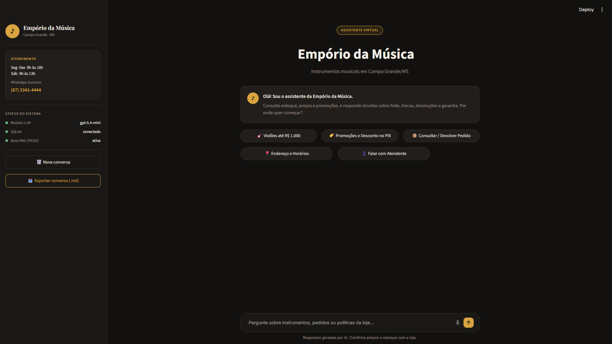
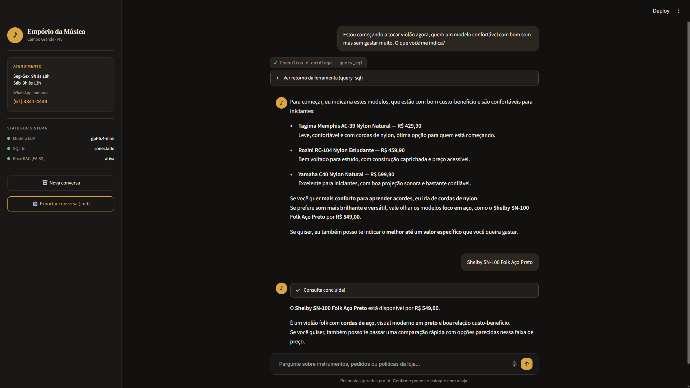
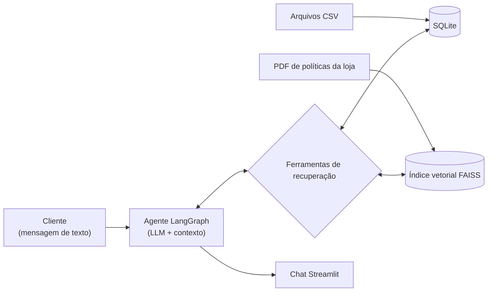

# Empório da Música — Assistente Virtual de Atendimento

[](README.md)

Um assistente conversacional full-stack para uma loja fictícia de instrumentos musicais em Campo Grande, Brasil. Ele responde a dúvidas de clientes sobre produtos, preços, estoque, promoções, pedidos e políticas da loja.

A aplicação combina **Text-to-SQL** para dados estruturados da loja e **RAG** para documentos de políticas. O **LangGraph** orquestra o fluxo de trabalho do agente, e o **Streamlit** fornece a interface de chat.

## Prévia da Aplicação

| Interface principal (Design no Figma) | Exemplo de conversa (Consulta ao catálogo) |
|---|---|
|  |  |

## Exemplos de Interação

> 📸 **Transcrições completas dos testes e capturas de tela:**  
> Para consultar os registros completos, passo a passo, incluindo consultas SQL, resultados da recuperação de políticas e capturas da interface, veja [**`examples/exemplos_conversas.md`**](examples/exemplos_conversas.md).

### 1. Consulta de Produtos e Disponibilidade

- **Cliente:** "Estou começando a tocar violão agora, quero um modelo confortável com bom som mas sem gastar muito. O que você me indica?"
- **Assistente:** Recomenda opções acessíveis com cordas de nylon e confortáveis para iniciantes (Tagima Memphis AC-39 por R$ 429,90, Rozini RC-104 por R$ 459,90 e Yamaha C40 por R$ 599,90) e sugere uma alternativa com cordas de aço (Shelby SN-100 Folk por R$ 549,00) para quem busca um som acústico mais brilhante.
- **Cliente:** "Shelby SN-100 Folk Aço Preto"
- **Assistente:** Confirma a disponibilidade e o preço (R$ 549,00) diretamente na view de catálogo do SQLite (`vw_catalogo_produtos`).

### 2. Consulta de Status do Pedido (Híbrida com Políticas da Loja)

- **Cliente:** "Olá! Sou o Lucas Mendes da Silva, fiz o pedido #4. Qual foi o produto que comprei, qual o status da entrega e se tiver defeito ou me arrepender, quais são as regras de devolução e garantia?"
- **Assistente:**
  - *Dados recuperados via SQL:* Pedido #4 (Giannini GF-3D Dreadnought Sunburst, R$ 799,90, status `delivered`).
  - *Políticas recuperadas via RAG:* direito de arrependimento em compras online por 7 dias, com frete de devolução gratuito; troca pela loja em caso de defeito em até 30 dias; e garantia do fabricante de 1 ano.

### 3. Pergunta sobre Política da Loja e Promoção Ativa

- **Cliente:** "O violão Taylor 110e Dreadnought está em promoção? Quanto fica no PIX?"
- **Assistente:** Confirma o desconto promocional ativo de 8% (R$ 5.999,00 -> R$ 5.519,08) e explica que o desconto de 5% no Pix não é cumulativo com promoções ativas, sendo aplicado o desconto mais vantajoso.

## Arquitetura

Os dados CSV são tratados e carregados no SQLite. O PDF com as políticas da loja é indexado no FAISS. Um agente LangGraph escolhe a ferramenta de recuperação apropriada e retorna a resposta por meio do Streamlit.



## Funcionalidades Principais

- **Catálogo de produtos:** preços, especificações, promoções e disponibilidade.
- **Acompanhamento de pedidos:** detalhes e status dos pedidos.
- **Políticas da loja:** respostas sobre envio, devoluções, garantias e procedimentos.
- **Recuperação híbrida:** SQL para dados estruturados e busca vetorial para documentos de políticas.
- **Interface de chat personalizada:** interface Streamlit com inspeção das ferramentas, exportação da conversa para Markdown e entrada opcional por voz.

## Tecnologias e Decisões de Projeto

| Área | Tecnologia | Finalidade |
|---|---|---|
| Orquestração do agente | LangGraph | Gerencia o fluxo entre agente e ferramentas e limita as iterações das ferramentas |
| LLM | `gpt-5.4-mini` | Interpreta solicitações, gera SQL e seleciona ferramentas de recuperação |
| Recuperação estruturada | SQLite + views SQL | Permite consultas precisas sobre produtos, estoque, promoções e pedidos |
| Recuperação semântica | FAISS + `text-embedding-3-small` | Recupera trechos relevantes das políticas da loja |
| Processamento de PDF | pypdf | Extrai o texto das políticas antes da divisão em trechos e indexação |
| Interface | Streamlit | Fornece a interface de atendimento ao cliente |

### Análise Exploratória e Preparação dos Dados

Antes de implementar o fluxo de recuperação, explorei as seis tabelas CSV e o documento com as políticas da loja em `notebooks/analise_exploratoria.ipynb`. Isso ajudou a identificar relacionamentos entre tabelas, campos relevantes, inconsistências nos dados e regras de negócio que precisavam ser refletidas na aplicação.

Com base nessa análise, os arquivos CSV são tratados e carregados no SQLite durante a inicialização, em vez de serem enviados diretamente ao LLM ou manipulados por meio de código Python/Pandas gerado em tempo de execução.

A preparação inclui:
- Remoção de espaços em branco desnecessários e normalização de valores selecionados.
- Definição do estoque de produtos descontinuados como zero, impedindo que apareçam como disponíveis mesmo quando o CSV de origem contém uma quantidade positiva.
- Extração de atributos selecionados dos produtos em formato JSON para campos relacionais, facilitando as consultas.

O SQLite e as views SQL fornecem uma camada de recuperação estruturada e reproduzível. As views `vw_catalogo_produtos` e `vw_pedidos_detalhados` consolidam informações do catálogo e dos pedidos e aplicam regras de negócio, incluindo a não cumulatividade do desconto de 5% no Pix com promoções ativas. Isso reduz a quantidade de junções e cálculos de regras de negócio que o LLM precisa realizar durante a consulta, ajudando a evitar SQL inconsistente e respostas incorretas.

A ferramenta `query_sql` inclui verificações básicas destinadas a restringir a execução a consultas somente de leitura. Essas verificações são uma proteção no nível da aplicação, não uma fronteira completa de segurança do banco de dados.

### Recuperação Híbrida: Text-to-SQL e RAG

As duas fontes de dados exigem estratégias de recuperação diferentes:

- **Text-to-SQL:** utilizado para perguntas precisas sobre produtos, preços, promoções, estoque e pedidos. O agente gera SQL com base no schema e nas views preparados do SQLite.
- **RAG:** utilizado para informações presentes em `politicas_loja.pdf`. O texto do PDF é dividido em trechos de 1.000 caracteres, com sobreposição de 200 caracteres, convertido em embeddings usando `text-embedding-3-small` e armazenado em um índice FAISS local. O retriever retorna os cinco trechos mais relevantes.

O agente pode chamar as duas ferramentas em uma única interação quando uma pergunta exige dados estruturados e informações sobre políticas.

### Escolha do LLM

O modelo `gpt-5.4-mini` foi selecionado para equilibrar capacidade de raciocínio, latência de resposta e custo operacional. Text-to-SQL é a parte mais exigente desta aplicação porque requer interpretar schemas relacionais, junções, filtros e regras de negócio antes de gerar uma consulta válida. Um modelo maior poderia aumentar o custo sem benefícios proporcionais para o fluxo de trabalho como um todo, enquanto um modelo menor poderia ter dificuldades com a geração de SQL mais complexa.

A escolha do modelo não significa que todos os componentes exigem um LLM grande. A geração de embeddings e a recuperação vetorial são tarefas separadas, e modelos locais menores podem ser suficientes para muitos casos de uso de RAG, como gerar embeddings de documentos ou produzir respostas simples fundamentadas nos trechos recuperados.

### Fluxo do Agente, Estratégia de Prompt e Contexto da Conversa

O LangGraph coordena um nó de agente e um nó de ferramentas. O agente decide se deve responder diretamente ou chamar `query_sql` e/ou `search_store_policies`. Ele pode utilizar os resultados das ferramentas em outro turno do agente antes de produzir a resposta final. Um limite configurável de iterações das ferramentas direciona a execução para uma etapa de finalização.

As instruções do prompt definem como o agente deve utilizar as fontes e ferramentas disponíveis, manter as respostas concisas e orientadas ao cliente, sugerir alternativas para produtos indisponíveis e lidar com perguntas fora do escopo ou tentativas de prompt injection. Elas também orientam o agente a fundamentar respostas factuais nas informações recuperadas, em vez de preencher lacunas com suposições. Essas instruções melhoram a consistência, mas não substituem a segurança no nível da aplicação.

O contexto da conversa é mantido em `st.session_state` do Streamlit durante a sessão ativa. O histórico persistente e a exigência de login não foram incluídos porque o desafio se concentra em um assistente informativo de atendimento ao cliente, não em transações autenticadas ou gerenciamento de chamados. O contexto limitado à sessão permite perguntas de acompanhamento sem adicionar a etapa de login para os visitantes da loja. Os clientes podem exportar a conversa como Markdown pela barra lateral.

## Estrutura do Projeto

```text
desafio-ai-engineer-artefact/
├── .streamlit/       # Configuração do tema do Streamlit
├── agent/            # Inicialização do chatbot, fluxo LangGraph, LLMs e ferramentas
├── data/             # Seis arquivos CSV e PDF com as políticas da loja
├── db/               # Limpeza dos CSVs, configuração do SQLite e views SQL
├── examples/         # Cenários documentados de conversas e capturas de tela
│   └── images/       # Capturas reais da interface da aplicação
├── notebooks/        # Análise exploratória das tabelas e regras de negócio
├── prompts/          # Prompt de sistema e regras de atendimento ao cliente
├── rag/              # Processamento de PDF e índice FAISS
├── ui/               # Interface Streamlit modular
├── app.py            # Ponto de entrada da aplicação
└── requirements.txt
```

## Instalação e Execução

### Requisitos

- Python 3.11+
- Chave de API da OpenAI para o LLM e os embeddings padrão (também utilizada pelo recurso opcional de entrada por voz)

### 1. Clone o repositório

```bash
git clone https://github.com/cesaryuri/desafio-ai-engineer-artefact.git
cd desafio-ai-engineer-artefact
```

### 2. Crie e ative um ambiente virtual

**Windows (PowerShell)**

```powershell
python -m venv .venv
.\.venv\Scripts\Activate.ps1
```

**Linux / macOS**

```bash
python3 -m venv .venv
source .venv/bin/activate
```

### 3. Instale as dependências

```bash
pip install -r requirements.txt
```

### 4. Configure as variáveis de ambiente

Crie um arquivo `.env` no diretório raiz do projeto e adicione suas credenciais de API.

Exemplo de configuração do `.env`:

```env
# Banco de dados (deixe vazio para utilizar automaticamente o SQLite local gerado em db/emporio_musica.db)
DATABASE_URL=""

# Provedor e modelo do LLM
LLM_PROVIDER="openai"
LLM_MODEL="gpt-5.4-mini"

# Embeddings do armazenamento vetorial RAG (FAISS)
EMBEDDING_PROVIDER="openai"
EMBEDDING_MODEL="text-embedding-3-small"

# Modelo de Speech-to-Text (entrada por voz)
OPENAI_STT_MODEL="gpt-4o-mini-transcribe"

# Chave de API
OPENAI_API_KEY="sua-chave-de-api-openai"

# Número máximo de iterações das ferramentas do agente por turno
MAX_AGENT_STEPS="10"
```

> **Nota de segurança:** não faça commit do arquivo `.env` nem exponha chaves de API. O arquivo `.env` já está incluído no `.gitignore`.

### 5. Execute a aplicação

```bash
streamlit run app.py
```

Na primeira execução, a aplicação limpa e importa os seis arquivos CSV para o SQLite, cria as views SQL e indexa `politicas_loja.pdf` no armazenamento FAISS local.

## Limitações e Melhorias Futuras

**Limitações atuais**
- O SQLite e o índice FAISS são locais à aplicação.
- O contexto da conversa é mantido apenas durante a sessão ativa do Streamlit; ele não é persistido entre sessões.
- **Contaminação de contexto em diálogos longos:** em sessões extensas com múltiplas interações (por exemplo, consultar um pedido de cliente e depois solicitar os contatos gerais de atendimento da loja), o LLM pode ocasionalmente recuperar detalhes específicos do cliente (como telefone ou e-mail de chamadas anteriores das ferramentas) em vez dos contatos oficiais da loja. Quando solicitado a esclarecer, o agente consulta corretamente `search_store_policies` e se corrige com os contatos oficiais da loja.
- A validação SQL é básica e não oferece segurança de banco de dados em nível de produção.
- O fluxo de trabalho atual utiliza um único LLM configurado, em vez de selecionar modelos de acordo com a tarefa.

**Possíveis melhorias**
- **Ferramenta determinística de atendimento da loja e mascaramento de PII:** adicionar uma ferramenta dedicada e determinística `get_store_info` para os canais oficiais da loja, em vez de depender da recuperação semântica via RAG, combinada com mascaramento de PII nos resultados SQL (por exemplo, `lu***@jmail.com`) para evitar que dados de clientes sejam expostos em respostas institucionais.
- **Avaliação de modelos específicos por tarefa:** comparar modelos com diferentes perfis de capacidade, custo e latência. Um modelo mais robusto poderia lidar com a geração de Text-to-SQL complexo, enquanto modelos locais menores (como variantes Llama ou Gemma) e modelos locais de embeddings poderiam ser avaliados para recuperação de políticas e tarefas de linguagem mais simples. Um modelo leve também poderia ser testado para sintetizar respostas finais após a execução das ferramentas. Qualquer estratégia de seleção de modelos deve ser validada em relação à qualidade das respostas, latência e custo antes de ser adotada.
- **Avaliação de qualidade:** criar um conjunto de testes que cubra correção de SQL, relevância da recuperação, consistência factual e utilidade das respostas. Frameworks como DeepEval poderiam apoiar a avaliação automatizada, complementada por uma revisão de pessoas familiarizadas com os produtos e as políticas da loja.
- **Preparação para produção:** adicionar sessões autenticadas de clientes, autorização de pedidos no servidor, histórico persistente de conversas e transferência para um atendente humano com resumo automático da conversa.
- **Aprimoramento da descoberta de produtos:** combinar filtros SQL com busca semântica nas descrições dos produtos.

## Desenvolvimento Assistido por IA

Utilizei Claude e Antigravity com Gemini como ferramentas de apoio ao desenvolvimento para exploração, auxílio na implementação e revisão de código.

A interface Streamlit foi desenvolvida com base em um protótipo no Figma, que ajudou a orientar o layout visual e a experiência do usuário. Sugestões geradas por IA foram revisadas e adaptadas aos requisitos do projeto, incluindo melhorias na inicialização do chatbot, nas respostas sobre disponibilidade de estoque voltadas ao cliente e na estilização da interface. A implementação final e as decisões técnicas foram avaliadas em relação aos requisitos do desafio.
